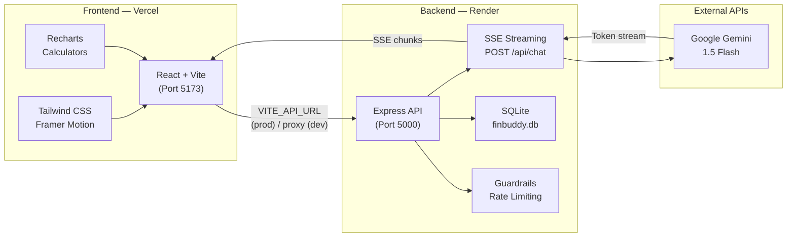
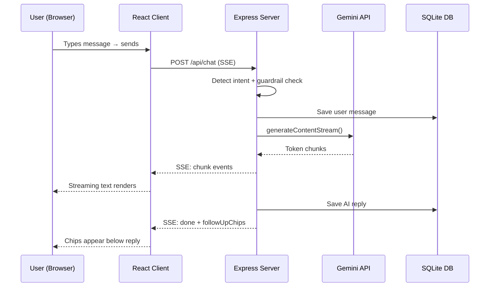

# 💸 FinBuddy AI

> **Your friendly AI-powered financial literacy assistant for Indian college students.**  
> Built with React + Vite, Node.js + Express, and the Gemini API.


---

## 🌟 Features

| Feature | Description |
|---|---|
| 🤖 **AI Chat** | Streaming responses powered by Gemini 1.5 Flash with SSE |
| 🇮🇳 **Indian Context** | Answers use ₹ INR, SIP, FD, PPF, UPI, CIBIL, Nifty 50 |
| 🛡️ **Guardrails** | Blocks guaranteed returns, stock tips & insider trading queries |
| 💬 **Follow-up Chips** | Smart quick-reply suggestions after every AI answer |
| 📊 **Calculators** | EMI, SIP, and 50/30/20 Budget with animated Recharts visuals |
| 🕘 **Chat History** | SQLite persistence with session management |
| 📥 **Export** | Download chats as plain text or styled HTML (print to PDF) |
| ⚠️ **Disclaimer Banner** | Dismissible "educational info only" notice |
| 🌗 **Dark / Light Mode** | Dark by default, toggle in header |
| 📱 **Mobile-first** | Responsive with bottom navigation on mobile |
| ✨ **Premium UI** | Glassmorphism, aurora background, Framer Motion animations |

---

## 🖼️ Screenshots

| Desktop — Welcome | Desktop — Tools |
|:---:|:---:|
|  |  |

| Mobile — Welcome | Mobile — Tools |
|:---:|:---:|
|  |  |

---

## 🏗️ Architecture



### Request Flow



---

## 📁 Project Structure

```
AI CHATBOAT/
├── client/                    # React + Vite frontend
│   ├── src/
│   │   ├── components/
│   │   │   ├── Header.jsx         # Nav, theme toggle
│   │   │   ├── Sidebar.jsx        # Session list, export
│   │   │   ├── Message.jsx        # Chat bubbles + markdown
│   │   │   ├── ChatInput.jsx      # Pill input bar
│   │   │   ├── WelcomeScreen.jsx  # Topic cards
│   │   │   ├── ToolsTab.jsx       # EMI / SIP / Budget calculators
│   │   │   ├── BottomNav.jsx      # Mobile navigation
│   │   │   ├── DisclaimerBanner.jsx  # ⚠️ Dismissible notice
│   │   │   ├── FollowUpChips.jsx  # Quick-reply suggestions
│   │   │   └── ExportButton.jsx   # Export chat (txt / html)
│   │   ├── services/api.js        # All API calls + SSE reader
│   │   ├── utils/confetti.js      # Canvas confetti on success
│   │   └── App.jsx               # Root state + routing
│   ├── .env.example
│   ├── tailwind.config.js         # Design tokens (fintech.violet etc.)
│   └── vite.config.js
│
├── server/                    # Node.js + Express backend
│   ├── src/
│   │   ├── routes/
│   │   │   ├── health.js          # GET /api/health
│   │   │   ├── chat.js            # POST /api/chat, export endpoints
│   │   │   └── calc.js            # EMI / SIP / Budget calculators
│   │   ├── services/
│   │   │   ├── gemini.js          # Gemini streaming + guardrails + chips
│   │   │   └── classifier.js      # Intent detection
│   │   ├── middleware/security.js # Rate limiting + sanitisation
│   │   ├── db.js                  # SQLite (node:sqlite)
│   │   └── index.js              # Express app + CORS
│   ├── test-calculators.mjs       # Unit tests: EMI / SIP / Budget
│   ├── test-questions.mjs         # 20 Q&A + 3 guardrail tests
│   ├── test-all-endpoints.mjs     # Integration tests (28 assertions)
│   ├── .env.example
│   └── package.json
│
├── vercel.json                # Vercel deployment config (frontend)
├── render.yaml                # Render deployment config (backend)
├── .env.example               # Root env example
└── README.md
```

---

## 🚀 Quick Start (Local Development)

### Prerequisites
- **Node.js ≥ 22** (uses built-in `node:sqlite`)
- A free [Google Gemini API key](https://aistudio.google.com/app/apikey)

### 1. Clone & Install

```bash
git clone https://github.com/your-username/finbuddy-ai.git
cd finbuddy-ai

# Install backend deps
cd server && npm install

# Install frontend deps
cd ../client && npm install
```

### 2. Configure Environment

```bash
# In /server — copy and fill in your Gemini key
cp .env.example .env
# Edit .env:  GEMINI_API_KEY=your_key_here
```

### 3. Run Both Servers

**Terminal 1 — Backend:**
```bash
cd server
npm run dev
# → http://localhost:5000/api/health
```

**Terminal 2 — Frontend:**
```bash
cd client
npm run dev
# → http://localhost:5173
```

> **No Gemini key?** The app runs in **Preview Mode** — all questions get pre-written educational fallback answers so you can still demo the full UI.

---

## 🧪 Tests

All test scripts spawn their own server instance on alternate ports.

```bash
cd server

# Calculator unit tests (EMI, SIP, Budget) — ~25 assertions
npm run test:calc

# 20 topic questions + 3 guardrail tests — quality + safety check
npm run test:questions

# Full endpoint integration tests — 28 assertions
npm run test:all
```

---

## 🌐 Deployment

### Backend → Render (Free tier)

1. Push code to GitHub
2. Go to [render.com](https://render.com) → **New → Web Service**
3. Connect your repo, set **Root Directory** = `server`
4. Set these environment variables in Render Dashboard:
   | Key | Value |
   |---|---|
   | `GEMINI_API_KEY` | Your Gemini API key |
   | `CLIENT_URL` | `https://your-app.vercel.app` |
   | `NODE_ENV` | `production` |
   | `PORT` | `10000` |
5. Deploy — your API will be at `https://finbuddy-api.onrender.com`

> The `render.yaml` file at the repo root automates this with **Infrastructure as Code**.

### Frontend → Vercel

1. Go to [vercel.com](https://vercel.com) → **New Project** → import your repo
2. Set **Root Directory** = `client`
3. Set this environment variable in Vercel Dashboard:
   | Key | Value |
   |---|---|
   | `VITE_API_URL` | `https://finbuddy-api.onrender.com` |
4. Deploy — Vercel will auto-run `npm run build` with `vercel.json` config

> **SPA routing**: `vercel.json` already includes the rewrite rule `/* → /index.html`.

---

## 🔧 API Reference

### `POST /api/chat`
Accepts a message and streams the reply as Server-Sent Events.

**Request:**
```json
{ "message": "How do I start an SIP?", "history": [], "sessionId": "uuid" }
```

**SSE Events:** `metadata` → `chunk` (×N) → `done`

**Done payload includes:**
```json
{
  "intent": "investments",
  "isGuardrailed": false,
  "followUpChips": ["Calculate my SIP growth 📈", "What is Nifty 50?"],
  "reply": { "id": "...", "content": "...", "category": "investments" }
}
```

### `POST /api/calc/emi`
```json
{ "principal": 200000, "annualRate": 10, "tenureMonths": 24 }
```

### `POST /api/calc/sip`
```json
{ "monthlyInvestment": 1000, "annualRate": 12, "years": 5 }
```

### `POST /api/calc/budget`
```json
{ "income": 10000 }
```

### `GET /api/history/export/text?sessionId=<id>`
Downloads conversation as a `.txt` file.

### `GET /api/history/export/html?sessionId=<id>`
Downloads conversation as a styled `.html` file (Ctrl+P to save as PDF).

---

## 🛡️ Safety & Guardrails

FinBuddy has two layers of safety:

1. **System Prompt Rules** — The AI is instructed to never guarantee returns, recommend specific stocks, or discuss insider trading.

2. **Server-side Pattern Matching** — `containsUnsafeQuery()` in `gemini.js` checks each message against 17 regex patterns *before* calling Gemini. If triggered:
   - Gemini is never called (no API cost)
   - A safe, educational response is streamed instead
   - The `done` event includes `isGuardrailed: true`

**Guardrailed patterns include:**
- Guaranteed returns / sure-shot investments
- Specific stock tips / hot stock picks
- Insider trading / market manipulation
- Pump and dump schemes

---

## 🎨 Design System

Design tokens defined in `client/tailwind.config.js`:

| Token | Color | Usage |
|---|---|---|
| `fintech.violet` | `#7C3AED` | Primary accent, AI bubbles border |
| `fintech.pink` | `#EC4899` | User bubbles, gradient end |
| `fintech.cyan` | `#22D3EE` | Highlights, streaming cursor |
| `fintech.lime` | `#A3E635` | Success states, copy check |
| `fintech.bg` | `#0B0B14` | Background deep navy |

---

## 🔮 Future Improvements

- [ ] **Voice input** — Web Speech API for hands-free questions
- [ ] **PDF export** — Server-side PDF generation with `pdfkit`
- [ ] **Multi-language** — Hindi / regional language support
- [ ] **Goal tracker** — Set and track financial goals (emergency fund, SIP target)
- [ ] **Quiz mode** — Financial literacy quiz with score tracking
- [ ] **Nudges / reminders** — Browser notifications for savings check-ins
- [ ] **OAuth login** — Google sign-in to sync history across devices
- [ ] **PostgreSQL** — Swap SQLite for Postgres on Render for persistent storage
- [ ] **Spend analyser** — Upload UPI statement CSV, get spending breakdown
- [ ] **More calculators** — PPF maturity, compound interest, tax estimator
- [ ] **PWA** — Offline support and home-screen install

---

## ⚠️ Disclaimer

> FinBuddy provides **financial education only** — not certified financial, investment, or tax advice. All calculator results and AI answers are for learning purposes. Consult a SEBI-registered financial advisor for personalised guidance. Investments are subject to market risks; past performance does not guarantee future returns.

---

## 📄 License

MIT © 2024 — Built with ❤️ for Indian college students.
